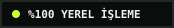
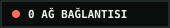
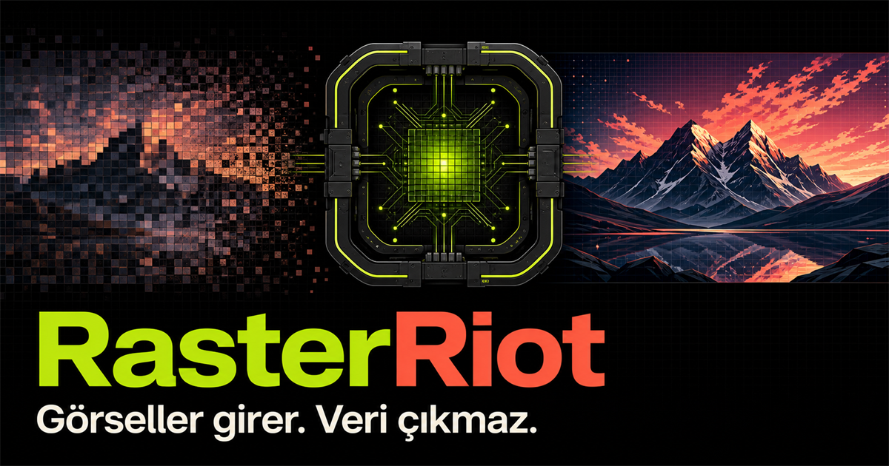

# RasterRiot

 



**Görseller girer. Veri çıkmaz.** RasterRiot; PNG, JPEG, WebP ve tarayıcının desteklediği AVIF görsellerini hiçbir sunucuya yüklemeden toplu biçimde sıkıştıran, boyutlandıran, kırpan, dönüştüren ve metadata'dan arındıran bir tarayıcı laboratuvarıdır.

[Canlı uygulamayı aç](https://muhammetefesahan.github.io/RasterRiot/)

## Neden farklı?

- Tek seferde 200 görsele kadar sıralı, bellek kontrollü işleme
- Web, sosyal kare, OG kartı, e-posta ve yalnızca metadata temizleme reçeteleri
- Canlı önce/sonra kıyası, gerçek çıktı boyutu ve tasarruf hesabı
- WebP, JPEG, PNG, AVIF ve kaynak formatta yeniden kodlama
- Kırp/sığdır/esnet, döndür, çevir, renk ayarları ve metin filigranı
- Bir dosyadaki hata diğerlerini durdurmaz; tamamlananlar yine ZIP'e girer
- Harici ZIP paketi yok: CRC32 dahil küçük, denetlenebilir bir ZIP yazıcısı
- PWA kurulumu ve daha önce açılmış sürüm için çevrimdışı çalışma
- Çalışma zamanında bağımlılık, analiz kodu, izleyici ve arka uç yok

## Üç hamlede

1. Görselleri bırak.
2. Bir reçete seç veya ayarları değiştir.
3. Tek görseli indir ya da tüm kuyruğu ZIP olarak al.

## Gizlilik modeli

Görseller `File`, `Blob`, `Canvas` ve nesne URL'leriyle yalnızca açık tarayıcı sekmesinde işlenir. Canvas ile yeniden kodlama EXIF, GPS ve diğer kaynak metadata bloklarını çıktıya taşımaz. Sayfanın içerik güvenlik politikası `connect-src 'none'` olduğu için uygulama `fetch`, XHR, WebSocket veya benzeri bir veri bağlantısı kuramaz. Statik uygulama dosyalarının ilk kez yüklenmesi dışında görsel işleme sırasında ağ kullanılmaz.

Dosyalar sekme kapanınca tarayıcı belleğinden ayrılır. Kodda kullanıcıya ait IP, e-posta, dosya yolu, API anahtarı veya erişim belirteci bulunmaz.

## Güvenlik sınırları

- En fazla 200 dosya
- Dosya başına en fazla 50 MB
- Kuyrukta en fazla 500 MB kaynak veri
- Çıktı başına en fazla 16 megapiksel
- Filigran metni 80 karakter
- Güvenli, normalize edilmiş ve çakışmasız çıktı adları

Bu sınırlar özellikle mobil tarayıcıların sekmeyi bellek baskısı nedeniyle kapatmasını önlemeye yardımcı olur. Çok büyük kuyruklarda masaüstü tarayıcı önerilir.

## Format notları

Tarayıcı hem çözme hem kodlama özelliklerini belirler. RasterRiot açılışta WebP ve AVIF çıktı desteğini gerçek bir canvas kodlama denemesiyle ölçer ve desteklenmeyen seçenekleri kapatır. HEIC/HEIF yaygın ve tutarlı bir tarayıcı kod çözücüsüne sahip olmadığı için açık bir uyarıyla reddedilir; önce JPEG/PNG'ye dönüştürülmelidir.

## Yerelde çalıştırma

Derleme yoktur. Klasörde bir statik sunucu açman yeterli:

```bash
python -m http.server 4200
```

Ardından `http://localhost:4200/` adresine git.

## Test

```bash
npm run verify
```

Testler saf geometri, sınırlar, güvenli dosya adları, CRC32 ve ZIP yapısını kapsar. GitHub Actions ayrıca JavaScript sözdizimini ve uygulama kaynaklarında ağ API'si bulunmadığını denetler.

## Mimari

Detaylı tasarım ve veri akışı için [docs/ARCHITECTURE.md](docs/ARCHITECTURE.md) dosyasına bak.

## Tasarım araştırması

Ürün akışı iki ayrı değerlendirme turuyla sınandı. Erişilebilir kuyruk navigasyonu, ilerlemeli ayarlar, bellek/piksel bütçeleri, iptal sonrası kısmi ZIP ve görünür gizlilik kanıtları bu turlardan ürüne taşındı. Uygulama hiçbir dış servisi çalışma zamanında çağırmaz.

## Lisans

[MIT](LICENSE)
